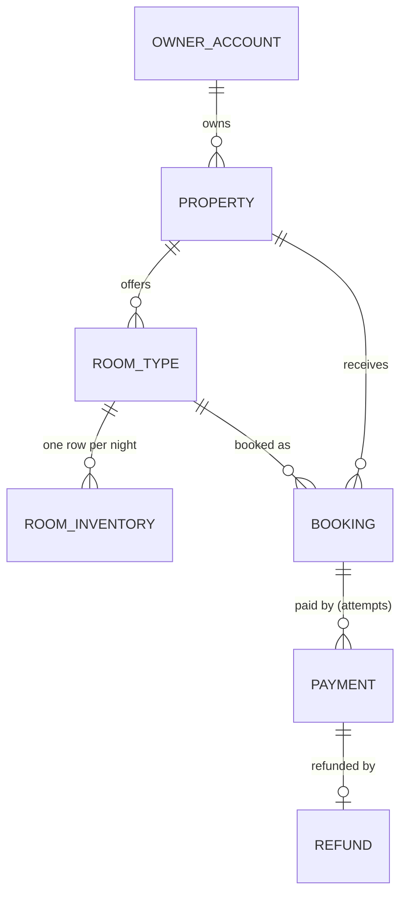
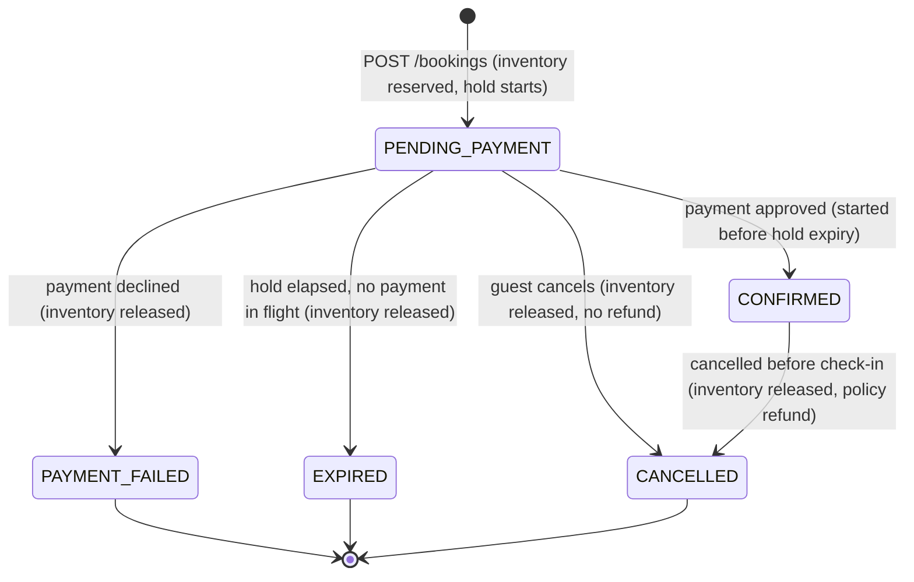
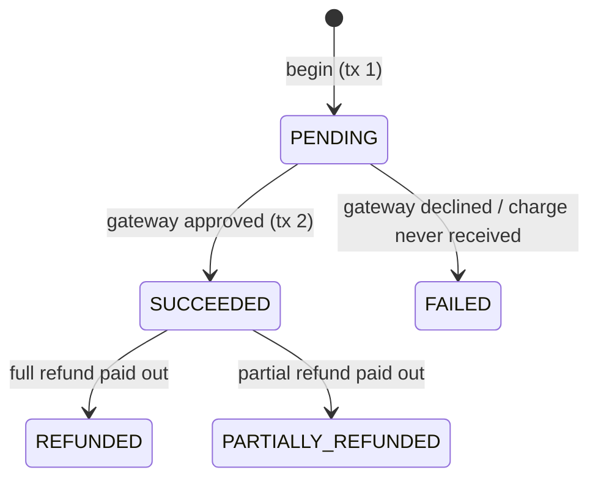

# Hotel Booking System

A Spring Boot service for onboarding hotels, searching availability, booking rooms, taking payments and handling
cancellations with refunds. It was built as an SDE-3 machine coding submission. The focus is on correctness under
concurrency, clear domain modelling and extension points that follow the open/closed principle.

## Contents

1. [Project overview](#1-project-overview)
2. [Functional requirements implemented](#2-functional-requirements-implemented)
3. [Technology stack](#3-technology-stack)
4. [Architecture and package structure](#4-architecture-and-package-structure)
5. [Domain entity relationships](#5-domain-entity-relationships)
6. [Booking lifecycle](#6-booking-lifecycle)
7. [Payment lifecycle](#7-payment-lifecycle)
8. [Inventory management](#8-inventory-management)
9. [Concurrency handling](#9-concurrency-handling)
10. [Payment strategy design](#10-payment-strategy-design)
11. [Cancellation policy design](#11-cancellation-policy-design)
12. [API endpoints](#12-api-endpoints)
13. [Sample requests and responses](#13-sample-requests-and-responses)
14. [Error response format](#14-error-response-format)
15. [Database configuration](#15-database-configuration)
16. [Build and run](#16-build-and-run)
17. [Running the tests](#17-running-the-tests)
18. [Key assumptions](#18-key-assumptions)
19. [Design decisions and trade-offs](#19-design-decisions-and-trade-offs)
20. [Future enhancements](#20-future-enhancements)

---

## 1. Project overview

The system covers the full path from supply to booking:

- **Supply onboarding.** Owners register properties and room types. Each room type gets per-night inventory.
- **Discovery.** Guests search by city, locality, dates and party size, with optional price, amenity and star-rating
  filters. Only properties with a room type free for every night of the stay are returned.
- **Booking.** A booking reserves inventory immediately in a `PENDING_PAYMENT` state, for a limited hold period.
- **Payment.** CARD, UPI and WALLET payments go through a pluggable gateway. An idempotency key makes retries safe.
  Success confirms the booking; failure releases the rooms.
- **Cancellation.** A pluggable policy decides the refund, the rooms are released immediately, and the refund is
  paid out through the gateway with retry support.
- **Background jobs.** These expire unpaid holds, reconcile payments the gateway didn't answer, retry pending
  refunds and roll the inventory horizon forward.

## 2. Functional requirements implemented

| Requirement | How it is met |
|-------------|---------------|
| Standalone properties and multi-property owners | A single `OwnerAccount` model. A standalone hotel is an owner with one property, and `POST /properties/standalone` is a convenience endpoint that uses the same code path. |
| Different room types per property | `RoomType` belongs to a `Property`, with its own capacity, inventory and base price. |
| Search by location, dates and guests | `GET /api/v1/properties/search` with city, locality, check-in, check-out, guests and rooms. |
| Price, amenities and star-rating filters | Optional `minPrice`, `maxPrice`, `amenities` (all must match) and `minStarRating`. |
| Book a specific room type for a date range | `POST /api/v1/bookings`. The room type must belong to the property. |
| Prevent double booking | Per-night inventory rows, locked pessimistically while a booking is created. |
| Payment success confirms a booking | `PENDING_PAYMENT → CONFIRMED`, only after a gateway approval. |
| Payment failure doesn't confirm a booking | A decline moves the booking to `PAYMENT_FAILED` and releases its rooms. |
| Cancellation releases inventory | The rooms are released in the same transaction that cancels the booking. |
| Interfaces at extension points | `PaymentProcessor`, `PaymentGateway`, `RefundGateway`, `CancellationPolicy`, `CancellationPolicyResolver`, `RoomTypeSearchFilter`, `PriceCalculator` |
| Payment idempotency | The `Idempotency-Key` header, bound to a request fingerprint and backed by a unique constraint. |
| Hold expiry, refund retry, reconciliation | Scheduled maintenance jobs (see [Inventory management](#8-inventory-management) and [Payment lifecycle](#7-payment-lifecycle)). |

## 3. Technology stack

| Concern | Choice |
|---------|--------|
| Language | Java 25 |
| Framework | Spring Boot 4.2.0 (Web MVC, Data JPA, Validation, Actuator) |
| Persistence | Hibernate via Spring Data JPA, H2 in-memory database |
| Build | Maven (wrapper included: `mvnw` / `mvnw.cmd`) |
| Testing | JUnit 5, Mockito, AssertJ, Spring Boot Test, MockMvc, `@DataJpaTest` |
| Other | Lombok, H2 console |

## 4. Architecture and package structure

The code uses a layered architecture with dependencies pointing inward:

```
HTTP ──► api (controllers, DTOs, error mapping)
            │  DTOs only; entities never leave the service layer
            ▼
         service (use cases, transactions, orchestration)
            │  depends on interfaces: gateways, policies, filters, pricing
            ▼
         domain (entities, value objects, invariants, state machine)
            ▲
         repository (Spring Data JPA interfaces, queries, locks)
```

- **Controllers** are thin. They validate the request shape, delegate to a service and map HTTP status codes.
- **Services** own the transaction boundaries and coordinate repositories, locks and gateways.
- **Entities** guard their own invariants and state transitions, for example `Booking.confirm` and
  `RoomInventory.reserve`. An illegal transition can't be expressed, whichever service calls it.
- **Repositories** contain queries and lock hints only, never business rules.

```
com.rupeek.hotel_booking_system
├── api
│   ├── controller      Owner, Property, PropertySearch, Booking, Payment, BookingCancellation, Refund
│   ├── dto             Request/response records per module (onboarding, search, booking, payment, cancellation)
│   └── error           GlobalExceptionHandler (RFC 9457 problem details)
├── config              Clock, inventory/booking/maintenance properties, cancellation policy beans, scheduling
├── domain
│   ├── model           OwnerAccount, Property, RoomType, RoomInventory, Booking, Payment, Refund,
│   │                   embeddables Location, GuestDetails, StayPeriod; BaseEntity (id, @Version, audit)
│   ├── enums           BookingStatus, PaymentStatus, RefundStatus, PaymentMethod, Amenity, CancellationPolicyType
│   ├── cancellation    CancellationPolicy, TieredCancellationPolicy, NonRefundableCancellationPolicy, RefundDecision
│   ├── exception       DomainException hierarchy (validation, state, inventory, payment)
│   └── common          DomainPreconditions, MonetaryAmounts
├── repository          Spring Data JPA repositories and projections
└── service
    ├── onboarding      PropertyOnboardingService, RoomInventoryProvisioner
    ├── search          PropertySearchService, SearchCriteria, filter/ (one RoomTypeSearchFilter per criterion)
    ├── booking         BookingService
    ├── inventory       InventoryReservationService, RoomAvailabilityCalculator
    ├── pricing         PriceCalculator, BaseRatePriceCalculator
    ├── payment         PaymentService, PaymentProcessorRegistry, processor/ (Card, Upi, Wallet), gateway/ (ports + mock)
    ├── cancellation    BookingCancellationService, CancellationPolicyResolver
    ├── refund          RefundService
    ├── maintenance     BookingHoldExpiryService, InventoryHorizonService, MaintenanceJobs
    └── exception       ResourceNotFoundException, DuplicateResourceException
```

## 5. Domain entity relationships



| Entity | Key fields | Notes |
|--------|------------|-------|
| `OwnerAccount` | name, email (unique, case-insensitive), phone | Individual owner or chain; owns 1..n properties |
| `Property` | name, `Location` (address, locality, city), star rating 1–5, amenities, cancellation policy type, time zone | Normalised `searchCity`/`searchLocality` columns are indexed for search |
| `RoomType` | name (unique per property), description, max guests per room, total inventory, base price | |
| `RoomInventory` | room type, stay date, total rooms, booked rooms | Unique on (room type, date); the unit of locking |
| `Booking` | property, room type, `GuestDetails`, `StayPeriod` (check-in/check-out), guests, rooms, total price, status, hold expiry | Holds references to both property and room type; the property is derived from the room type, so they can't disagree |
| `Payment` | booking, amount, method, status, idempotency key (unique), request fingerprint, transaction reference (unique), refunded amount | A booking can have several attempts; at most one can be `PENDING` at a time |
| `Refund` | payment (unique), amount, status, reference, attempts | At most one refund per payment |

Additional notes:
- All monetary fields are `BigDecimal` and all stay dates are `LocalDate`.
- Every entity extends `BaseEntity`, which provides the id, an optimistic `@Version`, and `createdAt`/`updatedAt`.
- Associations are `LAZY` `@ManyToOne` on the owning side.
- Responses are built from DTOs, so there are no bidirectional serialisation cycles.

## 6. Booking lifecycle



- Transitions are defined once in `BookingStatus.allowedTransitions()` and enforced by `Booking`. Anything else
  throws `InvalidBookingStateException`, which maps to 409.
- Only `PENDING_PAYMENT` and `CONFIRMED` bookings hold inventory (`BookingStatus.holdsInventory()`). Moving to
  any terminal state releases the rooms in the same transaction.
- The hold lasts `hotel.booking.hold-duration` (default 15 minutes). A payment that started within the hold can
  still confirm the booking, even if the gateway answers just after the hold ends.
- A confirmed booking can be cancelled only before check-in, which is 14:00 on the check-in date in the
  property's time zone.

## 7. Payment lifecycle



`PaymentService.pay` never calls the gateway while a database transaction or row lock is held:

1. **Validate.** The processor's `prepare` step validates the instrument without touching the database.
2. **Begin (transaction 1).** Lock the booking row with `SELECT … FOR UPDATE`.
   - If the `Idempotency-Key` was used before, it must belong to the same booking and the same request
     fingerprint. The fingerprint is a SHA-256 of the booking, method and instrument; the instrument itself is
     never stored.
     - A different request with the same key returns 409.
     - A completed payment is replayed with 200 and `Idempotent-Replayed: true`, without a second charge.
     - A `PENDING` payment is resumed with the same key.
   - Otherwise, check that the booking is payable and that no other payment for it is `PENDING`, then insert a
     `PENDING` payment and commit.
   - If the hold has already expired, the booking is expired, its rooms are released and 409 is returned.
3. **Charge.** The processor calls the gateway with no transaction open. The gateway is idempotent on the key.
4. **Complete (transaction 2).** Lock the booking row again and apply the decision.
   - Approval: the payment becomes `SUCCEEDED` and the booking `CONFIRMED`. If the booking can no longer be
     confirmed, for example because it was cancelled meanwhile, a refund is recorded instead.
   - Decline: the payment becomes `FAILED`, the booking `PAYMENT_FAILED`, and its rooms are released. The guest
     must create a new booking.

**When the gateway gives no decision:**
- The payment stays `PENDING`, the booking keeps its rooms, and the API returns 503.
- Retrying with the same key resumes the same charge, so the guest is charged at most once.
- If nobody retries, the **payment reconciliation job** settles the payment from the gateway's recorded decision
  (`PaymentGateway.findCharge`). A charge the gateway never received is marked failed.

**Refunds:** `PENDING → SUCCEEDED | FAILED`.
- A refund that got no answer stays `PENDING` and is re-sent with the same key by the refund retry job.
- A `FAILED` refund can be retried through `POST /api/v1/refunds/{id}/retry`, which uses a new attempt key.

## 8. Inventory management

**Model.** `room_inventory` has one row per room type per night, holding `totalRooms` and `bookedRooms`. A night's
availability is `totalRooms − bookedRooms`, and a stay's availability is the minimum over its nights.

**Provisioning.**
- Adding a room type creates rows from today, in the property's time zone, for `hotel.inventory.horizon-days`
  (default 365) nights.
- The daily **inventory horizon job** (`InventoryHorizonService`) appends the nights that come into the horizon,
  so inventory never runs out as time passes. It is idempotent: a second run adds nothing.

**Reserve and release.**
- Creating a booking increments `bookedRooms` on every night of the stay.
- A decline, an expiry or a cancellation decrements them in the same transaction as the state change.
- `RoomInventory` refuses to go below 0 or above `totalRooms`.

**Rules:**
- A night with no inventory row is treated as not on sale, and the room type is unavailable for that stay.
- `PAYMENT_FAILED`, `EXPIRED` and `CANCELLED` bookings never consume inventory.
- `BookingRepository` also offers an overlap query over inventory-holding statuses, for reporting and verification.

**Expired holds.** The **hold expiry job** expires `PENDING_PAYMENT` bookings whose hold has passed and releases
their rooms. It skips bookings that have a payment in flight, which reconciliation settles instead.

**Search efficiency.** A search always issues three SQL statements, whatever the number of results:
1. Room types with their properties, fetch-joined and filtered by specifications.
2. One grouped aggregate of minimum availability over the stay.
3. One batched load of amenities.

This avoids N+1 queries.

## 9. Concurrency handling

| Flow | Mechanism |
|------|-----------|
| Booking creation | `InventoryReservationService` locks the stay's `room_inventory` rows with `PESSIMISTIC_WRITE` (`SELECT … FOR UPDATE`, 5s lock timeout), in ascending date order. It checks every night, then increments, inserts the booking and commits. |
| Payment / cancellation / expiry | Each locks the **booking row** first, then the inventory rows if it releases rooms. |
| Refund payout | Locks the refund row in a short transaction of its own. |
| All entities | `@Version` optimistic locking as a safety net against lost updates. |
| Duplicates | Unique constraints on the idempotency key, transaction reference, refund-per-payment, room-type name per property, owner email, and inventory (room type, date). |

**Guarantees:**
- **No overselling.** Concurrent requests that share a night are serialised on that night's row. The capacity check
  and the increment happen under the same lock.
- **No deadlocks.** Locks are always taken in the same order: the booking row, then inventory rows in date order.
  Booking creation never locks booking rows.
- **Disjoint stays don't block each other**, because locks are per night.
- **Lock timeout.** If the inventory lock can't be obtained in time, the request returns 409 (`Concurrent update`)
  with nothing changed, so it is safe to retry.
- **Gateways are never called while a lock is held.** Slow gateways can't hold the inventory or booking rows
  locked.

`BookingConcurrencyTest`, `PaymentApiIntegrationTest` and the end-to-end suite fire simultaneous requests from a
thread pool. They assert exact outcomes: the number of successful bookings equals the available rooms, and there
is exactly one charge per idempotency key.

## 10. Payment strategy design

```
PaymentService ──► PaymentProcessorRegistry (EnumMap<PaymentMethod, PaymentProcessor>)
                          │
          ┌───────────────┼────────────────┐
  CardPaymentProcessor  UpiPaymentProcessor  WalletPaymentProcessor   (extend GatewayPaymentProcessor)
          └───────────────┴────────┬───────┘
                                   ▼
                     PaymentGateway (port) ◄── MockPaymentGateway (hotel.payment.gateway=mock)
```

- **Strategy.** `PaymentProcessor` has two operations:
  - `prepare` validates and extracts the instrument:
    - CARD: Luhn check, expiry and CVV.
    - UPI: VPA format.
    - WALLET: provider and wallet id.
  - `charge` sends the charge to the gateway.
- **No branching on the method.** `PaymentProcessorRegistry` builds an `EnumMap` from all processor beans, and
  `PaymentService` has no `if`/`switch` on the method.
  - A method with no processor is rejected with 400 (`UnsupportedPaymentMethodException`).
  - Two processors for the same method fail at startup.
- **Adding a method:** add a `PaymentMethod` constant, a request DTO field and one `PaymentProcessor` bean.
  `PaymentService` doesn't change.
- **Gateway port.** `PaymentGateway` and `RefundGateway` are interfaces, so a real provider can be another bean.
  `MockPaymentGateway` is the default. It is deterministic and replays its first answer for a repeated key.
  - Instruments ending in `0002` are declined: card `4000000000000002`, wallet `9000000002`.
  - UPI addresses starting with `fail@` are declined.
  - Everything else is approved. Refunds are always approved.
- **Security.** The amount is always the booking total and is never taken from the client. Card details are sent
  only to the gateway; they are never persisted, logged or returned.

## 11. Cancellation policy design

```
BookingCancellationService ──► CancellationPolicyResolver ──► CancellationPolicy.evaluate(CancellationContext)
                                (PropertyCancellationPolicyResolver)          └─► RefundDecision(percentage, amount, rule)
```

- `CancellationPolicy` is a domain interface. `CancellationContext` carries the paid amount, the check-in instant
  and the cancellation instant.
- `TieredCancellationPolicy` is a composition of notice-period tiers: the most generous tier whose notice is met
  applies. `NonRefundableCancellationPolicy` always refunds nothing.
- The default policies, registered as beans in `CancellationPolicyConfiguration`:

  | Policy | Refund |
  |--------|--------|
  | `FLEXIBLE` | 100% if cancelled ≥ 24h before check-in, otherwise nothing |
  | `MODERATE` | 100% if ≥ 7 days before, 50% if ≥ 48h before, otherwise nothing |
  | `NON_REFUNDABLE` | Nothing |

- Each property chooses its policy type at onboarding. `PropertyCancellationPolicyResolver` maps types to beans,
  and startup fails if a type has no bean or two beans.
- **Replacing a policy.** Swap a policy bean, or provide a `@Primary` `CancellationPolicyResolver`, for example for
  per-room-type or promotional rules. `BookingCancellationService` and `BookingService` don't change.

**Cancellation flow:**
1. **One transaction.**
   - Lock the booking row.
   - Reject the request with 409 if the booking is already cancelled, in a terminal state, past check-in, or has
     a payment still awaiting the gateway.
   - Otherwise, mark the booking `CANCELLED`, evaluate the policy, record a `PENDING` refund (only when there is
     a successful payment and a positive amount), release the inventory, and commit.
2. **After commit.** `RefundService` sends the refund and records the outcome.
   - The payment becomes `REFUNDED` or `PARTIALLY_REFUNDED`.
   - A gateway outage never undoes the cancellation; the refund stays `PENDING` for the retry job.

## 12. API endpoints

Base path: `/api/v1`. All bodies are JSON. Errors use `application/problem+json`.

### Onboarding
| Method | Path | Description | Success |
|--------|------|-------------|---------|
| POST | `/owners` | Create an owner account | 201 + `Location` |
| GET | `/owners/{ownerId}` | Owner with all properties | 200 |
| POST | `/owners/{ownerId}/properties` | Add a property to an owner | 201 + `Location` |
| POST | `/owners/{ownerId}/properties/batch` | Add 1–50 properties (all or nothing) | 201 |
| POST | `/properties/standalone` | Create an owner and its single property | 201 + `Location` (owner) |
| GET | `/properties/{propertyId}` | Property with its room types | 200 |
| POST | `/properties/{propertyId}/room-types` | Add a room type and provision its inventory | 201 |

### Search
| Method | Path | Description |
|--------|------|-------------|
| GET | `/properties/search` | Available properties and room types for a stay |

| Parameter | Required | Rules |
|-----------|----------|-------|
| `city` | yes | Case- and whitespace-insensitive |
| `locality` | no | Case- and whitespace-insensitive |
| `checkIn`, `checkOut` | yes | ISO dates. `checkIn` not in the past and before `checkOut`. At most 30 nights. |
| `guests` | yes | 1–100 |
| `rooms` | no | 1–10, default 1. `rooms ≤ guests ≤ rooms × 10`. |
| `minPrice`, `maxPrice` | no | Inclusive range on the per-night price. `minPrice ≤ maxPrice`. |
| `amenities` | no | Comma-separated, for example `WIFI,GYM`. The property must have all of them. |
| `minStarRating` | no | 1–5 |

- A room type qualifies when it passes every filter, `maxGuests × rooms ≥ guests`, and at least `rooms` are free
  on every night.
- Results are sorted by lowest price, then star rating (descending). They are not paginated.

### Booking
| Method | Path | Description | Success |
|--------|------|-------------|---------|
| POST | `/bookings` | Create a `PENDING_PAYMENT` booking | 201 + `Location` |
| GET | `/bookings/{bookingId}` | Booking details | 200 |
| GET | `/properties/{propertyId}/bookings?status=&page=0&size=20` | Paginated bookings for a property (size 1–100), optional status filter | 200 |

Booking rules:
- `guests` must be 1–100 and `rooms` 1–10.
- `checkIn` must be before `checkOut`, not in the past, with at most 30 nights.
- The room type must belong to the property.
- `rooms ≤ guests ≤ rooms × maxGuests` and `rooms ≤ totalInventory`.
- Every night must have at least `rooms` free.

### Payment
| Method | Path | Description | Success |
|--------|------|-------------|---------|
| POST | `/bookings/{bookingId}/payments` + header `Idempotency-Key` | Pay for a booking | 201 for a new attempt (approved **or** declined; see `status`); 200 + `Idempotent-Replayed: true` on replay |
| GET | `/bookings/{bookingId}/payments` | All attempts for a booking, newest first | 200 |
| GET | `/payments/{paymentId}` | Payment details | 200 |
| GET | `/payments?transactionReference=…` | Find a payment by gateway reference | 200 |

`Idempotency-Key` is required. It is at most 100 characters of letters, digits and `_ . : -`.

### Cancellation and refunds
| Method | Path | Description | Success |
|--------|------|-------------|---------|
| POST | `/bookings/{bookingId}/cancellation` | Cancel a booking and compute its refund | 200 |
| GET | `/refunds/{refundId}` | Refund details | 200 |
| POST | `/refunds/{refundId}/retry` | Retry a `FAILED` refund (409 for any other state) | 200 |

### Operations
| Method | Path | Description |
|--------|------|-------------|
| GET | `/actuator/health` | Spring Boot Actuator health check |
| GET | `/h2-console` | H2 web console |

## 13. Sample requests and responses

These were captured from a running instance. Ids, timestamps and mock references will differ when you run them.

**Create an owner**
```http
POST /api/v1/owners
{"name": "Sunrise Hotels Pvt Ltd", "email": "ops@sunrisehotels.example", "phone": "+919800000001"}
```
```http
201 Created
Location: /api/v1/owners/1

{"id":1,"name":"Sunrise Hotels Pvt Ltd","email":"ops@sunrisehotels.example","phone":"+919800000001"}
```

**Add a property** (`timeZone` is optional and defaults to `Asia/Kolkata`)
```http
POST /api/v1/owners/1/properties
{
  "name": "Sunrise MG Road",
  "location": {"addressLine": "12 MG Road", "locality": "Indiranagar", "city": "Bengaluru"},
  "starRating": 4,
  "amenities": ["WIFI", "SWIMMING_POOL"],
  "cancellationPolicy": "MODERATE"
}
```
```http
201 Created
Location: /api/v1/properties/1

{"id":1,"ownerId":1,"name":"Sunrise MG Road",
 "location":{"addressLine":"12 MG Road","locality":"Indiranagar","city":"Bengaluru"},
 "starRating":4,"amenities":["WIFI","SWIMMING_POOL"],"cancellationPolicy":"MODERATE","timeZone":"Asia/Kolkata"}
```

**Add properties in a batch / create a standalone property**
```http
POST /api/v1/owners/1/properties/batch
{"properties": [{"name": "Sunrise Koramangala", "location": {...}, "starRating": 3, "amenities": ["WIFI"],
                 "cancellationPolicy": "FLEXIBLE", "timeZone": "Asia/Kolkata"}]}

POST /api/v1/properties/standalone
{"owner": {"name": "Asha Homestay", "email": "asha@homestay.example"},
 "property": {"name": "Asha Homestay", "location": {"addressLine": "3 Beach Rd", "locality": "Calangute", "city": "Goa"},
              "starRating": 2, "cancellationPolicy": "NON_REFUNDABLE"}}
```
The standalone call returns the owner with `"propertyCount":1` and the property.

**Add a room type**
```http
POST /api/v1/properties/1/room-types
{"name": "Deluxe King", "description": "King bed, city view", "maxGuests": 2, "totalInventory": 5, "basePrice": 2500.00}
```
```http
201 Created

{"id":1,"propertyId":1,"name":"Deluxe King","description":"King bed, city view","maxGuests":2,"totalInventory":5,"basePrice":2500.00}
```

**Search**
```http
GET /api/v1/properties/search?city=Bengaluru&checkIn=2026-12-20&checkOut=2026-12-23&guests=4&rooms=2&amenities=WIFI&maxPrice=3000
```
```json
{"checkIn":"2026-12-20","checkOut":"2026-12-23","nights":3,"guests":4,"rooms":2,"resultCount":1,
 "results":[{"propertyId":1,"name":"Sunrise MG Road",
   "location":{"addressLine":"12 MG Road","locality":"Indiranagar","city":"Bengaluru"},
   "starRating":4,"amenities":["WIFI","SWIMMING_POOL"],"cancellationPolicy":"MODERATE","lowestPricePerNight":2500.00,
   "availableRoomTypes":[{"roomTypeId":1,"name":"Deluxe King","description":"King bed, city view","maxGuests":2,
     "availableRooms":5,"pricePerNight":2500.00,"totalPrice":15000.00}]}]}
```
The `Family Suite` (4200.00 per night) is excluded by `maxPrice`, and `Sunrise Koramangala` has no room types.

**Create a booking**
```http
POST /api/v1/bookings
{"propertyId": 1, "roomTypeId": 1, "checkIn": "2026-12-20", "checkOut": "2026-12-23", "guests": 4, "rooms": 2,
 "guest": {"fullName": "Ravi Kumar", "email": "ravi@example.com", "phone": "+919811111111"}}
```
```http
201 Created
Location: /api/v1/bookings/1

{"id":1,"status":"PENDING_PAYMENT","propertyId":1,"propertyName":"Sunrise MG Road","roomTypeId":1,"roomTypeName":"Deluxe King",
 "checkIn":"2026-12-20","checkOut":"2026-12-23","nights":3,"guests":4,"rooms":2,"totalPrice":15000.00,
 "guest":{"fullName":"Ravi Kumar","email":"ravi@example.com","phone":"+919811111111"},
 "holdExpiresAt":"2026-11-25T02:43:54.809053","confirmedAt":null,"cancelledAt":null,"createdAt":"2026-11-24T20:58:54.823042Z"}
```

**Pay (approved), then replay the same key**
```http
POST /api/v1/bookings/1/payments
Idempotency-Key: pay-7f3c9a

{"method": "CARD", "card": {"cardNumber": "4111111111111111", "holderName": "Ravi Kumar", "expiryMonth": 12, "expiryYear": 2030, "cvv": "123"}}
```
```http
201 Created
Location: /api/v1/payments/1
Idempotent-Replayed: false

{"id":1,"bookingId":1,"bookingStatus":"CONFIRMED","amount":15000.00,"method":"CARD","status":"SUCCEEDED",
 "transactionReference":"MOCK-CARD-7602e3dc-…","failureReason":null,"idempotencyKey":"pay-7f3c9a",
 "completedAt":"2026-11-25T02:28:54.866052","refundedAmount":0.00,"createdAt":"2026-11-24T20:58:54.860049Z"}
```
Repeating the identical request returns `200 OK` with `Idempotent-Replayed: true` and the same body; nothing is
charged again. Reusing the key with a different body, such as `{"method":"UPI",…}`, returns 409:
`"Idempotency key 'pay-7f3c9a' was already used for a different payment request"`.

Other instrument shapes:
```json
{"method": "UPI", "upi": {"vpa": "ravi@okbank"}}
{"method": "WALLET", "wallet": {"provider": "PAYTM", "walletId": "9876543210"}}
```

**Pay (declined)**
```http
POST /api/v1/bookings/2/payments
Idempotency-Key: pay-upi-001

{"method": "UPI", "upi": {"vpa": "fail@okbank"}}
```
```json
201 Created
{"id":2,"bookingId":2,"bookingStatus":"PAYMENT_FAILED","amount":2500.00,"method":"UPI","status":"FAILED",
 "transactionReference":"MOCK-UPI-ebc38d57-…","failureReason":"UPI payment declined by issuer","idempotencyKey":"pay-upi-001",
 "completedAt":"2026-11-25T02:28:54.904460","refundedAmount":0.00,"createdAt":"2026-11-24T20:58:54.902459Z"}
```

**Property bookings**
```http
GET /api/v1/properties/1/bookings?status=CONFIRMED&page=0&size=20
```
```json
{"content":[{"id":1,"status":"CONFIRMED", "...": "..."}],"page":0,"size":20,"totalElements":1,"totalPages":1}
```

**Cancel** (MODERATE policy, more than 7 days before check-in, so the refund is 100%)
```http
POST /api/v1/bookings/1/cancellation
```
```json
200 OK
{"bookingId":1,"bookingStatus":"CANCELLED","cancelledAt":"2026-11-25T02:28:54.949462","cancellationPolicy":"MODERATE",
 "paidAmount":15000.00,"refundPercentage":100,"refundAmount":15000.00,
 "refundRule":"MODERATE: cancelled at least 7 day(s) before check-in",
 "refund":{"id":1,"paymentId":1,"amount":15000.00,"status":"SUCCEEDED","refundReference":"MOCK-REFUND-7092db68-…",
           "failureReason":null,"processedAt":"2026-11-25T02:28:54.966464"}}
```
- Afterwards, `GET /api/v1/bookings/1/payments` shows the payment as `"status":"REFUNDED","refundedAmount":15000.00`.
- A second cancellation returns 409: `"Booking 1 is already cancelled"`.
- Retrying a refund that already succeeded returns 409: `"Only a failed refund can be retried; refund 1 is SUCCEEDED"`.

**Insufficient inventory**
```json
409 Conflict
{"detail":"Room type 1 has 1 room(s) available on 2026-12-20 but 2 requested","status":409,"title":"Business rule violated"}
```

## 14. Error response format

Every error is an RFC 9457 problem detail (`Content-Type: application/problem+json`), produced by
`GlobalExceptionHandler`:

```json
{"title": "Validation failed", "status": 400, "detail": "Request validation failed",
 "errors": [{"field": "guest.email", "message": "must be a well-formed email address"},
            {"field": "guests", "message": "must be greater than or equal to 1"}]}
```

`errors` appears only for bean-validation failures. Other errors carry `title`, `status` and `detail`:

```json
{"title": "Validation failed", "status": 400, "detail": "checkOut must be after checkIn"}
{"title": "Resource not found", "status": 404, "detail": "Booking with id 9999 was not found"}
```

| Status | Title | When |
|--------|-------|------|
| 400 | Validation failed | Bean validation; domain validation, such as invalid dates, guest capacity, a room type not in the property, an invalid payment instrument or an unsupported method |
| 400 | Malformed request / Bad Request | Unreadable JSON, unknown enum value, invalid parameter type, missing `Idempotency-Key` header |
| 404 | Resource not found | Owner, property, room type, booking, payment or refund not found |
| 409 | Duplicate resource | Owner email or room-type name already exists |
| 409 | Business rule violated | Insufficient inventory, illegal state transition, hold expired, payment in progress, idempotency key reused for a different request, already cancelled, cancellation after check-in, refund not retryable |
| 409 | Concurrent update | Inventory row lock timed out; nothing changed, so retry |
| 409 | Conflict | A unique constraint caught a race (details are not leaked) |
| 503 | Payment gateway unavailable | The gateway gave no decision. The payment stays pending; retry with the same `Idempotency-Key`. |
| 500 | Internal error | Unexpected failure; details are logged, not returned |

## 15. Database configuration

`src/main/resources/application.yaml`:

| Setting | Value |
|---------|-------|
| JDBC URL | `jdbc:h2:mem:hotel_booking;DB_CLOSE_DELAY=-1;LOCK_TIMEOUT=5000` |
| Credentials | user `sa`, empty password |
| Schema | `spring.jpa.hibernate.ddl-auto=create-drop`, generated from the entities, including indexes and unique constraints |
| JDBC time zone | `hibernate.jdbc.time_zone=UTC` |
| Batch fetching | `hibernate.default_batch_fetch_size=50` |
| Open-in-view | Disabled; entities are mapped to DTOs inside the service transactions |
| H2 console | `http://localhost:8080/h2-console` |

Indexes:
- `property` (search city, search locality) and the owner.
- `booking` (room type, status, stay), the property, (status, hold expiry) and the guest email.
- `payment` booking, and (status, initiated at).
- `refund` (status, requested at).
- Unique `room_inventory` (room type, stay date).

Application settings:

| Property | Default | Purpose |
|----------|---------|---------|
| `hotel.inventory.horizon-days` | 365 | How many nights of inventory are kept on sale |
| `hotel.booking.hold-duration` | 15m | How long a pending booking holds its rooms |
| `hotel.payment.gateway` | `mock` | Activates `MockPaymentGateway` |
| `hotel.property.default-time-zone` | `Asia/Kolkata` | Zone for properties onboarded without one |
| `hotel.maintenance.scheduling-enabled` | `true` | Turns the scheduled jobs on or off |
| `hotel.maintenance.batch-size` | 100 | Maximum items each job run processes |
| `hotel.maintenance.hold-expiry-interval` | 1m | Hold expiry job interval |
| `hotel.maintenance.payment-reconciliation-interval` / `-grace` | 1m / 2m | Reconciles payments pending longer than the grace period |
| `hotel.maintenance.refund-retry-interval` / `refund-retry-grace` | 5m / 2m | Re-sends refunds pending longer than the grace period |
| `hotel.maintenance.inventory-horizon-cron` | `0 5 0 * * *` | Daily horizon top-up |

Each job processes every item in its own short transaction, so one failure doesn't stop the batch.

## 16. Build and run

Prerequisite: JDK 25. Maven is provided by the wrapper.

```bash
./mvnw clean package          # compile, test and build target/hotel-booking-system-0.0.1-SNAPSHOT.jar
./mvnw spring-boot:run        # start on http://localhost:8080
java -jar target/hotel-booking-system-0.0.1-SNAPSHOT.jar
```

On Windows use `mvnw.cmd`. To use another port, pass `--server.port=8089`, for example
`./mvnw spring-boot:run -Dspring-boot.run.arguments=--server.port=8089`.

The data is in memory and is lost on restart.

## 17. Running the tests

```bash
./mvnw test                                      # full suite (325 tests)
./mvnw test -Dtest=HotelBookingEndToEndIntegrationTest
./mvnw test -Dtest=PaymentServiceTest
```

No external services are needed: payments and refunds use the in-process mock gateway. The test configuration
disables the scheduler (`hotel.maintenance.scheduling-enabled=false`), and tests invoke the jobs explicitly so they
stay deterministic.

| Layer | Location | Focus |
|-------|----------|-------|
| Domain | `domain/**` | Entity invariants, the booking state machine, stay periods, cancellation policy maths, JPA mappings |
| Repository | `repository/**` (`@DataJpaTest`) | Inventory, overlap and search queries, pessimistic lock behaviour |
| Service | `service/**` (Mockito; H2 for search and concurrency) | Onboarding, each search filter, booking validation and pricing, payment strategies, idempotency and reconciliation, cancellation and refunds, hold expiry, horizon extension, concurrent bookings |
| API | `api/*ApiIntegrationTest` (MockMvc) | Each module's HTTP contract, status codes and error bodies |
| Recovery | `api/MaintenanceAndRecoveryIntegrationTest` | Hold expiry, horizon top-up and refund retries, using a movable clock and a switchable refund gateway |
| End-to-end | `e2e/HotelBookingEndToEndIntegrationTest` | Seven flows over HTTP only: onboarding, discovery, successful booking, failed payment, cancellation, double booking, concurrent booking |

Isolation and determinism:
- The end-to-end and recovery suites use their own H2 databases (`e2e_flows`, `maintenance_flows`).
- The end-to-end suite uses a fixed `Clock` and the recovery suite a movable one, so holds, refund windows and
  "today" never depend on real time.
- The other API suites share the default test database. Every test onboards its own owner, properties and room
  types, so the data never collides.
- Unit tests use fixed clocks.
- Concurrency tests assert exact counts.

## 18. Key assumptions

- **Ownership.** One owner account per legal entity. A standalone hotel is an owner with one property. There is
  no authentication or authorisation; any caller can act for any owner or guest.
- **Inventory.** Inventory is per room type, not per physical room. Room assignment happens at check-in, outside
  this system. Rooms are sold per night, with check-out day exclusive.
- **Pricing.** The price is `basePrice × nights × rooms` (`BaseRatePriceCalculator`), with no taxes, fees,
  discounts or seasonal rates. The price filter applies to the per-night base price.
- **Capacity.** `maxGuests` is per room, and every booked room has at least one guest. `rooms ≤ totalInventory`.
- **Stays.** At most 30 nights and no past check-in dates. "Today" is evaluated in the property's time zone.
  Check-in is 14:00 local time and is fixed.
- **Payments.**
  - A booking is paid in full, in one currency (implicit INR), with one successful payment.
  - A declined booking can't be paid again, so the guest books again.
  - The gateway is the source of truth for charges and refunds.
- **Cancellation.**
  - Guests can cancel `PENDING_PAYMENT` bookings (no refund) and `CONFIRMED` bookings before check-in.
  - There are no partial cancellations and no booking modifications.
  - The policy is the one on the property at cancellation time; it is not stored on the booking.
- **Timestamps.** `holdExpiresAt`, `confirmedAt`, `cancelledAt` and `completedAt` are server-local
  `LocalDateTime` values from the application `Clock`. `createdAt` is a UTC `Instant`.
- **Single instance.** The scheduled jobs assume a single application instance.

## 19. Design decisions and trade-offs

| Decision | Why | Trade-off |
|----------|-----|-----------|
| Per-night inventory rows instead of counting overlapping bookings | The capacity check is O(nights), and the row is a natural, fine-grained lock target. Search becomes a single aggregate. | Rows must be provisioned ahead of time and the horizon maintained by a job. Changing `totalInventory` later would need a migration of rows (not implemented). |
| Pessimistic locking for booking creation | Contention is concentrated on popular nights, where optimistic retries would thrash. A lock gives exact, simple correctness. | Requests are serialised per night, and the lock timeout surfaces as 409 under extreme contention. |
| Booking row lock for payment and cancellation | Serialises all state changes to one booking, including duplicate requests, with a consistent lock order. | Slightly more locking than strictly necessary for reads. |
| Gateway calls outside transactions (begin, charge, complete) | No database lock is held during network I/O, and outages don't roll back business state. | More states (`PENDING` payments and refunds) and the need for reconciliation and retry jobs. |
| Idempotency in the database with a request fingerprint | Survives restarts and works across instances. Detects key reuse with a different body. | One extra unique index and hashing per request. |
| Refund issued after the cancellation commits | The guest's cancellation and the released rooms never depend on gateway availability. | The refund is eventually consistent (`PENDING` until paid out). |
| Strategy plus registry for payments | Open/closed: a new method doesn't touch the service. The `EnumMap` lookup is O(1) and duplicates are detected at startup. | Slightly more classes than a `switch`. |
| Specification-based search filters | Each filter is an independent bean (single responsibility), and new filters don't change `PropertySearchService`. | Filters are always combined with AND; OR groups would need a richer model. |
| Composition for cancellation tiers | FLEXIBLE and MODERATE are data (tiers), not subclasses. New tiered policies are configuration. | Rules beyond notice periods, such as promotions, need a new `CancellationPolicy` implementation. |
| Rich domain entities | Invariants and transitions live in one place and are unit-tested without Spring. | Entities carry behaviour, so they are less trivially serialisable; DTO mapping is mandatory, which is intended. |
| H2 with `create-drop` | No setup is needed for reviewers, and tests are fast. | Not production storage; there are no migrations. |
| No search pagination | Results are bounded by city and filters, which keeps the API simple. | Large cities would need pagination or a search index. |

## 20. Future enhancements

None of these are implemented:

- **Security.** Authentication and authorisation, for example OAuth2/JWT, with owner-scoped onboarding and
  guest-scoped bookings, plus rate limiting.
- **Production persistence.** PostgreSQL with Flyway or Liquibase migrations, and Testcontainers-based tests.
- **Multi-instance operation.** A distributed scheduler lock (for example ShedLock) for the jobs, and a
  transactional outbox for gateway calls and notifications.
- **Real payment gateway.** A provider adapter for `PaymentGateway`/`RefundGateway` with webhooks feeding the
  existing reconciliation path.
- **Pricing.** Seasonal, dynamic or occupancy-based rates, taxes and discounts, as new `PriceCalculator`
  implementations.
- **Inventory management APIs.** Changing `totalInventory`, blocking dates (stop-sell), and per-night rate
  overrides.
- **Booking features.** Modifications (dates or rooms), partial cancellations, multi-room-type bookings and guest
  accounts with booking history.
- **Policy snapshot.** Storing the cancellation policy on the booking at creation time, so later policy changes
  don't affect existing bookings.
- **Search.** Pagination, sorting options, geo-radius search, and caching or a dedicated search index.
- **Observability and API docs.** Metrics and tracing for bookings, payments and jobs, plus an OpenAPI/Swagger
  specification.
- **Notifications.** Booking confirmation and cancellation emails or SMS.
